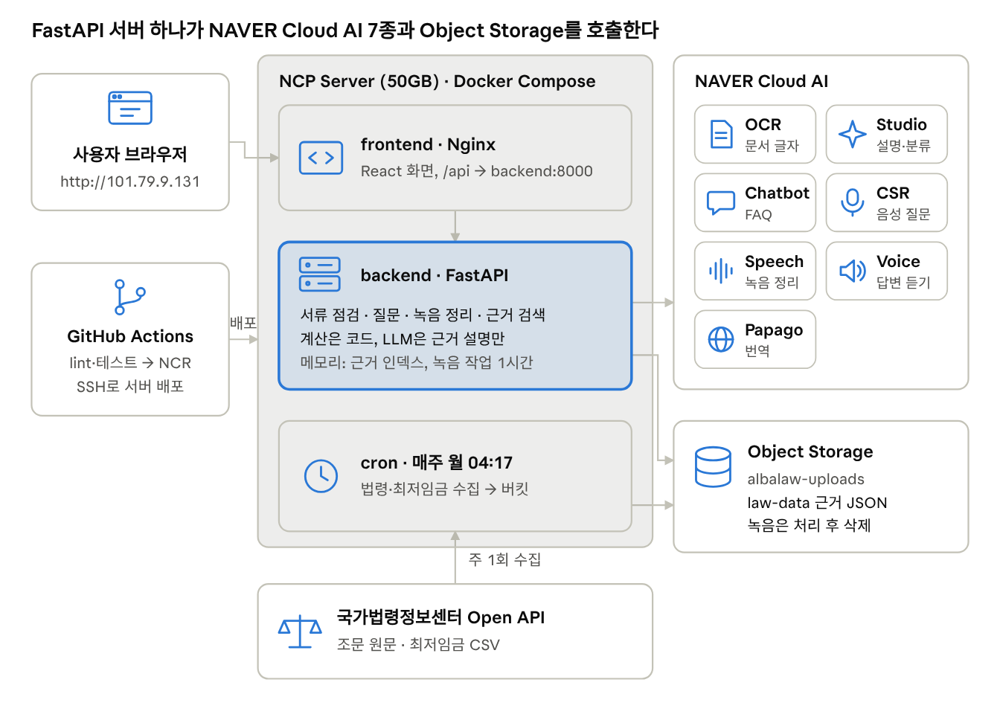

# Saver(알바생 노동권 지킴이) 기술 문서

작성: 이동건 · 2026-11-21

Saver는 아르바이트생을 위한 근로 서류 점검 웹 서비스다. 근로계약서나 급여명세서 사진을 올리면 시급과 근무시간을 읽어 최저임금, 주휴수당, 휴게시간을 점검하고, 그 결과를 법령 근거와 함께 쉬운 말로 설명한다. 텍스트·음성 질문과 대화 녹음 정리 기능도 있다.

| 항목 | 내용 |
| -------- | ------------------------------------------------------------ |
| 과정 | 네이버 클라우드 소버린 AI 리터러시 과정 팀 프로젝트(B안) |
| 운영 주소 | http://101.79.9.131 |
| 저장소 | [Naver-Saver/albalaw-guard](https://github.com/Naver-Saver/albalaw-guard) (공개) |
| 기준 버전 | main `22b5979` (2026-11-21 배포) |
| 명세 | `docs/PRD.md`, `docs/spec/` (요구사항, 기능, API, 데이터, AI 파이프라인), `docs/spec/openapi.yaml` |

금액과 시간 계산은 모두 백엔드 코드가 맡고, LLM은 근거 원문을 바탕으로 설명만 작성한다. 점검 결과는 법률 자문이 아니므로, 화면에서 고용노동부(1350)와 대한법률구조공단(132) 상담을 함께 안내한다.

## 1. 기술 스펙

프론트엔드는 React SPA이고, 백엔드는 FastAPI 서버 하나로 운영한다. 데이터베이스는 두지 않고 NAVER Cloud Object Storage의 JSON 파일과 서버 메모리만 사용한다.

| 영역 | 기술 | 비고 |
| ----------- | -------------------------- | ------------------------------------ |
| 프론트엔드 | React 19, Vite 8, TypeScript 7, oxlint | 해시 라우팅(`#/`, `#/guide`, `#/workspace`). 빌드 결과는 Nginx가 서빙 |
| 백엔드 | Python 3.12, FastAPI, Uvicorn(워커 1개), pydantic-settings, httpx, boto3 | 모든 응답을 `success`·`data`·`error` 형식으로 통일하고, 요청마다 `X-Request-ID` 부여 |
| 문서 인식 | CLOVA OCR | 계약서와 급여명세서의 글자를 읽은 뒤, 규칙 기반으로 항목 추출(BR-02) |
| 설명·요약 | CLOVA Studio HCX-005 | 근거 기반 설명과 녹음 타임라인 분류. 답변에 나온 숫자는 코드로 다시 검증(number guard) |
| 질문 | CLOVA Chatbot(FAQ), CLOVA Speech Recognition(CSR) | FAQ에 없는 질문은 Studio가 근거를 바탕으로 답변. 음성 질문은 60초까지 |
| 녹음 정리 | CLOVA Speech(장문 인식, 화자 분리) | 비동기로 인식하고, 결과 JSON은 버킷에서 읽은 즉시 삭제 |
| 번역·음성 | Papago, CLOVA Voice | 한국어, English, Tiếng Việt, 中文 지원. 답변을 mp3로 들려줌 |
| 근거 데이터 | 국가법령정보센터 Open API, 고용노동부 최저임금 CSV, 직접 작성한 Q&A | 조문 329건, Q&A 36건, 최저임금 14개 연도(2027년 10,700원 포함). 임베딩 없이 키워드로 검색 |
| 저장 | NCP Object Storage `albalaw-uploads` | `law-data/*.json`, `meta/sync_log.json`. 녹음 원본은 처리 후 삭제 |
| 인프라 | NCP Server(KVM, KR-2, Ubuntu, 디스크 50GB), Docker Compose, NCP Container Registry | Nginx(80번 포트)가 `/api` 요청을 백엔드(8000번 포트)로 전달. SSH는 키 인증만 허용 |
| CI/CD | GitHub Actions | PR마다 lint, 테스트, Docker 빌드, PR 제목을 검사. main에 머지되면 이미지 빌드, 배포, 스모크 테스트까지 자동 진행 |
| 정기 작업 | 서버 cron | 매주 월요일 04:17(KST)에 법령과 최저임금 데이터 수집(`python -m sync.all`). 서버는 600초마다 데이터를 다시 읽음 |
| 테스트 | pytest(백엔드 약 300건), node:test(프론트엔드 41건), ruff | OpenAPI 계약 테스트와 라우터 등록 누락 검사 포함 |

업로드 한도는 문서 10MB(jpg, png, pdf), 녹음 200MB·10분(m4a, mp3, wav), 음성 질문 10MB·60초다. 이용 안내 화면(`#/guide`)에는 팀이 직접 만든 30초 분량의 계약서 교육 영상이 있다. 내레이션은 CLOVA Voice로 합성했으며, CLOVA Dubbing은 사용하지 않았다(`docs/contract-education-video.md` 참고).

## 2. 아키텍처

브라우저의 요청은 먼저 Nginx가 받고, 그중 `/api` 요청만 FastAPI로 전달한다. FastAPI는 필요에 따라 NAVER Cloud AI 서비스와 Object Storage를 호출한다. 근거 데이터는 서버의 cron이 매주 법령 API에서 받아 버킷에 올린다.

### 기능별 요청 흐름

1. **계약서 점검**: 사진 업로드 → CLOVA OCR로 글자 인식 → 시급, 주 소정근로시간, 근무요일, 휴게시간, 적용 연도 추출 → 확인 화면에 자동 입력 → 사용자가 확인·수정 → 최저임금과 주휴수당 계산 → 항목별 근거 검색 → Studio가 설명 작성(숫자 검증 포함) → 결과 표시
2. **급여명세서 점검**: 사진 업로드 → OCR → 지급·공제 항목과 합계 추출 → 사용자가 확인·수정 → 합계 검산, 필수 기재 항목 확인, 최저임금 비교 → 근거 표시
3. **질문**: 텍스트 입력 또는 음성 질문(CSR) → Chatbot FAQ 조회 → FAQ에 없으면 근거 검색 후 Studio가 답변 → 선택한 언어로 번역(Papago)하고 답변 듣기(Voice) 제공
4. **녹음 정리**: 녹음 동의 후 업로드 → Object Storage에 저장 → CLOVA Speech 비동기 인식(화자 분리) → 결과 JSON 읽기 → Studio가 타임라인 분류 → 원본과 결과 파일 삭제 → 발언별 근거와 "말로 한 약속" 안내

### API

| 기능 | 메서드와 경로 |
| ------------ | -------------------------------------------------------- |
| 상태 확인 | `GET /api/health` |
| 계약서 | `POST /api/contracts/ocr`, `POST /api/contracts/review` |
| 급여명세서 | `POST /api/payslips/review` (OCR은 `doc_type=payslip`으로 호출) |
| 최저임금 | `GET /api/wage/minimum`, `POST /api/wage/check` |
| 근거 | `GET /api/qa/search`, `GET /api/law/sources/{source_id}` |
| 질문 | `POST /api/ask/text`, `POST /api/ask/voice` |
| 녹음 | `POST /api/recordings`, `GET /api/recordings/{job_id}`, `POST /api/recordings/evidence` |
| 번역·음성 | `POST /api/translate`, `POST /api/tts` |

### 데이터와 개인정보

- 데이터베이스는 사용하지 않는다. 근거 데이터는 버킷의 JSON을 읽어 600초 동안 캐시하고, 녹음 작업 상태는 서버 메모리에 1시간만 보관한다. 이 때문에 Uvicorn 워커는 1개로 운영한다.
- 문서 이미지는 메모리에서만 처리하고 저장하지 않는다. 녹음 원본과 CLOVA Speech 결과 JSON은 처리가 끝나는 즉시 삭제한다.
- API 키는 서버의 `backend.env`(권한 600)와 GitHub Secrets에만 두고, 저장소에는 올리지 않는다.

## 3. 발전 과정

프로젝트는 이틀 동안 다섯 단계로 진행했다. 기획과 인프라를 먼저 갖추고, 백엔드 뼈대, 데이터·AI 모듈, 화면을 차례로 만든 뒤 실제 API 연동으로 마무리했다. 아래 표는 최근 단계부터 정리했다.

| 날짜 | 단계 | 내용 |
| ------ | ------------- | ------------------------------------------------------ |
| 11-21 | 5. 실제 연동·안정화 | 모든 화면을 실제 API에 연결(계약서·급여명세서 점검, 텍스트·음성 질문, 답변 번역·듣기, 녹음 정리). OCR 추출값 자동 입력을 추가하고, 녹음 정리가 항상 실패하던 CLOVA Speech 결과 읽기 문제를 해결. 계약서 30초 교육 영상 제작 |
| 11-21 | 4. 화면 | 공통 UI, 소개·이용 안내, 언어 선택과 문서 업로드, 추출 확인, 점검 결과, 질문, 대화 기록 화면 구현 |
| 11-21 | 3. 데이터·AI 모듈 | 법령 근거 수집과 검색, 최저임금 데이터 일원화, Object Storage 연동, Papago 번역, CLOVA Voice, 질문 API, 급여명세서 점검·발언 근거 API, 법령 주간 수집 cron 구현. 서버 디스크를 10GB에서 50GB로 확장 |
| 11-21 | 2. 백엔드 뼈대 | 공통 응답과 오류 처리, OCR 항목 추출, Studio 공통 모듈과 숫자 검증, 서류 평가 구현. 첫 자동 배포 |
| 11-20 | 1. 기획·인프라 | PRD와 SDD 명세 작성, NCP 서버·레지스트리·CI/CD 구축, DB 대신 Object Storage를 쓰기로 결정, 수업 자료에 맞춰 키 체계 정리, CLOVA Chatbot FAQ 구성 |

진행 중에 바뀐 결정도 두 가지 있다. 처음에는 법제처 생활법령 API를 근거로 쓰려 했지만 호출 오류(코드 04)로 사용할 수 없어, 국가법령정보센터 조문과 직접 작성한 Q&A로 바꿨다. 또한 프로젝트 기간을 2주에서 1주로 줄였다.

## 4. 조원별 역할

네 명이 백엔드 뼈대와 배포, 데이터와 근거, 저장소와 음성, 화면을 나눠 맡았다. 담당 칸에는 GitHub 아이디를 적었으며, 실명은 팀에서 채워 넣을 예정이다.

| 담당 | 주요 산출물 | 역할 |
| ---------------- | ---------------------------------------------- | -------------- |
| 이동건 (Movinggun-bit) | PRD·SDD 명세, FastAPI 뼈대와 공통 응답, CLOVA OCR과 항목 추출, Studio 공통 모듈과 숫자 검증, 서류 평가, NCP 서버·CI/CD·법령 수집 cron, Chatbot 도메인 구성, 화면과 API 연동 마무리 | 백엔드 뼈대, 서류 점검, 인프라 |
| k-dong1 | 법령 조문·최저임금 수집(`sync`), 근거 검색(`law_search`)과 계산(`calc`), Papago 번역, 급여명세서 점검·발언 근거 API, 텍스트·음성 질문 API, 버킷 읽기 캐시 | 데이터, 근거, 질문 |
| SippZa | Object Storage 공통 모듈, CLOVA Speech 녹음 정리 API, 법령 로더의 버킷 연동, CLOVA Voice 음성 합성 API | 저장소, 녹음, 음성 |
| Unknown02-coder | 공통 UI와 퍼블리싱, 소개·이용 안내, 언어 선택과 문서 업로드, 추출 확인·점검 결과·질문·대화 기록 화면, OCR·번역·질문 연동, 계약서 30초 교육 영상 | 프론트엔드 |

PRD의 초기 역할안(프론트엔드, 백엔드·인프라, AI 파이프라인, 데이터·콘텐츠)과 비교하면 실제 분담은 위 표처럼 달라졌다. Chatbot FAQ 보강과 발표 자료는 담당자를 팀에서 확정해야 한다.
